# Orphelins : guide d'utilisation

_Orphelins_ (« Liens morts et médias orphelins » dans l'administration en français) est un plugin pour
[Dotclear](https://dotclear.org) qui vérifie les billets d'un blog et en tire un rapport :

* les **liens morts** : les liens qui ne répondent plus (la page a disparu, le site n'existe plus…),
* les **fichiers absents** : les images et les annexes utilisées par un billet, mais qui ne sont plus dans la médiathèque,
* les **médias inutilisés** : les médias de la médiathèque qu'aucun billet n'utilise.

Le plugin constate, il ne corrige rien. La seule action qui supprime quelque chose est la suppression de médias
inutilisés, que vous demandez vous-même, ligne par ligne, après confirmation. Rien n'apparaît sur la partie
publique du blog.

* [Installation et permissions](#installation-et-permissions)
* [Lancer une vérification](#lancer-une-vérification)
* [Les trois états de la page de vérification](#les-trois-états-de-la-page-de-vérification)
* [La liste « Liens et fichiers »](#la-liste--liens-et-fichiers-)
* [La liste « Médias inutilisés »](#la-liste--médias-inutilisés-)
* [Filtres et options d'affichage](#filtres-et-options-daffichage)
* [Agir sur plusieurs lignes](#agir-sur-plusieurs-lignes)
* [Le favori du tableau de bord](#le-favori-du-tableau-de-bord)
* [La tâche du plugin Maintenance](#la-tâche-du-plugin-maintenance)
* [Avec un assistant IA](#avec-un-assistant-ia)
* [Limites connues](#limites-connues)

## Installation et permissions

Le plugin demande Dotclear 2.40 et PHP 8.3 ou plus récent. Installez-le comme n'importe quel plugin, depuis la
page _Plugins_ de l'administration. Le serveur du blog doit pouvoir ouvrir des connexions vers d'autres sites web,
puisque c'est lui qui vérifie les liens.

Le rapport montre les liens de tous les billets du blog. Il est donc réservé aux personnes qui peuvent les gérer
tous : les administrateurs, et les personnes qui ont la permission **« gérer toutes les entrées et commentaires »**
sur le blog. Le plugin n'a pas de permission à lui.

Il apparaît dans le menu _Blog_, sous le nom **Liens morts et médias orphelins**.

## Lancer une vérification

Le rapport est vide tant qu'aucune vérification n'a eu lieu. Un bouton vert **Nouvelle vérification**, en haut à
droite des listes, ouvre la page de la vérification.

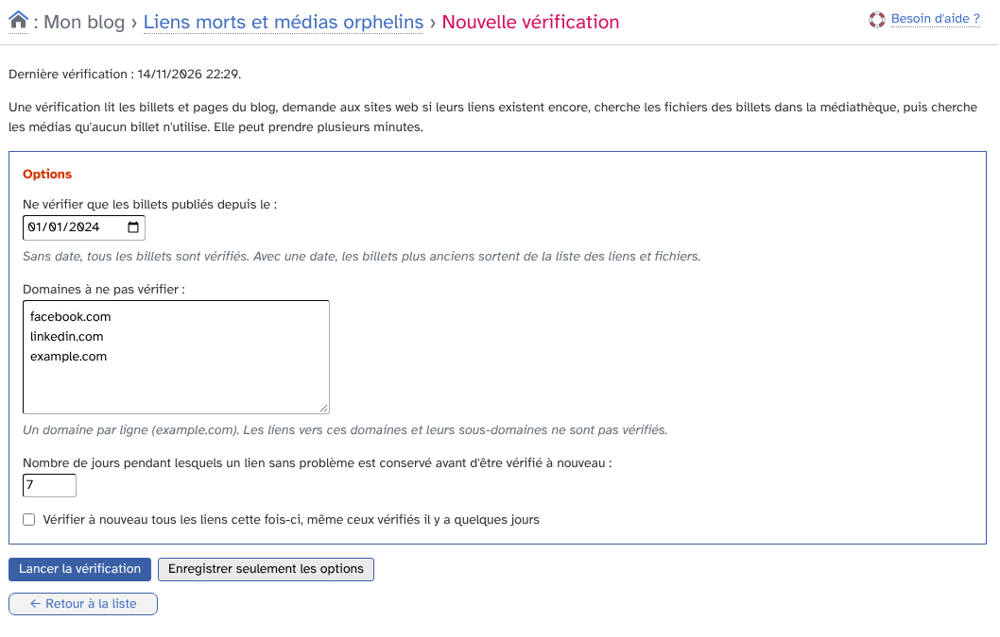

Une vérification lit tous les billets du blog, pages comprises, quels que soient leur type et leur état
(publié, brouillon…). Elle travaille en trois temps :

1. elle lit les billets et relève les liens, les images et les fichiers qu'ils contiennent,
2. elle demande à chaque site web si le lien existe encore,
3. elle cherche les médias de la médiathèque qu'aucun billet n'utilise.

Elle avance par étapes de quelques secondes, donc sans être arrêtée par la limite de temps du serveur. Selon
le nombre de liens, elle peut durer plusieurs minutes.

Les **options** se règlent sur la même page :

* **Ne vérifier que les billets publiés depuis le** : limite la vérification aux billets récents, d'après leur
  date de publication. Sans date, tous les billets sont vérifiés. Avec une date, les lignes des billets plus
  anciens quittent la liste des liens et fichiers. Les médias inutilisés restent justes : un média n'est jamais
  déclaré inutilisé à cause de cette date, puisque la recherche tient compte de tous les billets.
* **Domaines à ne pas vérifier** : un domaine par ligne (`example.com`). Les liens vers ces domaines et leurs
  sous-domaines ne sont pas demandés. C'est fait pour les sites qui refusent toujours les robots.
* **Nombre de jours pendant lesquels un lien sans problème est conservé avant d'être vérifié à nouveau** :
  7 par défaut. Un lien trouvé sans problème n'est pas redemandé à son site avant ce délai, ce qui accélère les
  vérifications suivantes. Les liens à corriger sont toujours redemandés.
* **Vérifier à nouveau tous les liens cette fois-ci, même ceux vérifiés il y a quelques jours** : ignore ce
  délai pour cette vérification seulement.

Le bouton **Lancer la vérification** enregistre les options et démarre. Le bouton **Enregistrer seulement les
options** les enregistre sans rien démarrer.

## Les trois états de la page de vérification

La page de vérification n'a que trois aspects, selon ce qui se passe.

**Pas de vérification.** C'est le formulaire des options, vu plus haut, avec la date de la dernière vérification.

**Vérification en cours.** La page affiche l'étape (« Étape 2 sur 3 : vérification des liens ») et le nombre de
lignes traitées.

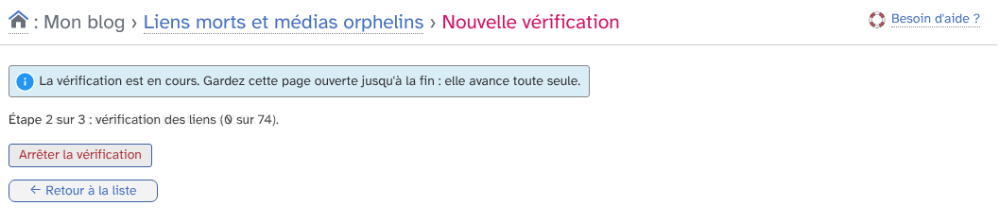

Gardez la page ouverte jusqu'à la fin : elle avance toute seule, en se rechargeant après chaque étape. Si
JavaScript est désactivé, un bouton **Étape suivante** apparaît et c'est à vous de cliquer. Le bouton
**Arrêter la vérification** conserve ce qui a déjà été vérifié ; le reste attend la prochaine vérification.
À la fin, la liste s'ouvre avec le message « La vérification est terminée. »

**Vérification quittée avant la fin.** Si vous quittez la page en cours de route, la vérification ne continue
pas toute seule : elle attend.

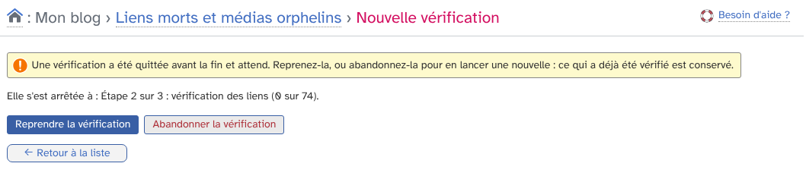

La page rappelle où elle s'est arrêtée. Le bouton **Reprendre la vérification** la continue ; le bouton
**Abandonner la vérification** l'abandonne, ce qui permet d'en lancer une nouvelle. Ce qui a déjà été vérifié
est conservé dans les deux cas. Tant qu'une vérification attend, le bouton vert des listes s'appelle
**Reprendre la vérification** au lieu de _Nouvelle vérification_.

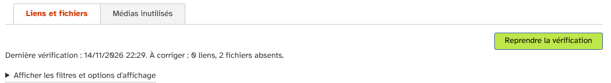

## La liste « Liens et fichiers »

Le rapport est fait de deux listes, sur deux pages reliées par des onglets : **Liens et fichiers** (la page du
plugin) et **Médias inutilisés**.

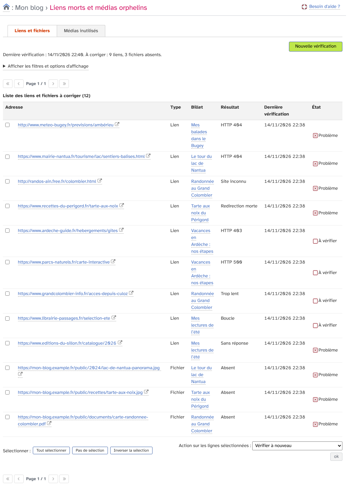

Au-dessus du tableau, une ligne donne la date de la dernière vérification et ce qui reste à corriger
(« À corriger : 9 liens, 3 fichiers absents »). Par défaut, la liste ne montre que ce qui est à corriger.

Les colonnes :

* **Adresse** : l'adresse du lien ou du fichier. Un clic l'ouvre, pour vérifier vous-même.
* **Type** : _Lien_ (une adresse demandée à son site web) ou _Fichier_ (une adresse de la médiathèque du blog,
  cherchée sur le disque).
* **Billet** : le billet qui contient l'adresse. Son titre mène à sa page de modification, pour corriger.
* **Résultat** : ce que la vérification a trouvé, en un ou deux mots (voir plus bas).
* **Dernière vérification** : la date où cette adresse a été vérifiée pour la dernière fois.
* **État** : le verdict.

### Les états

| État | Sens |
|---|---|
| **Problème** | Lien mort, fichier absent ou média inutilisé : à corriger |
| **À vérifier** | Le site n'a pas donné de réponse claire : il refuse peut-être les robots, demande une connexion, est trop lent ou en panne. Ouvrez le lien pour savoir |
| **Sans problème** | Le lien répond, le fichier existe |
| **Non vérifié** | Ligne en attente de sa vérification, lien vers un domaine à ne pas vérifier ou vers une adresse locale |
| **Ignoré** | Vous avez demandé à ne plus entendre parler de cette ligne |

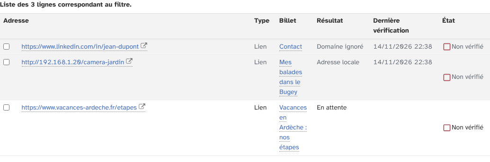

Les lignes _Non vérifié_ et _Ignoré_ sont grisées.

### Les résultats

| Résultat | Sens | État |
|---|---|---|
| **HTTP 404** (ou un autre numéro) | Le site a répondu avec ce code. 404 (page introuvable), 410 (page supprimée) et les autres erreurs 4xx sont des liens morts. Les codes 401, 403 et 429 (accès refusé, trop de demandes) et les erreurs 5xx (panne du site) restent à vérifier | Problème, ou À vérifier |
| **Site inconnu** | Le nom de domaine n'existe pas | Problème |
| **Sans réponse** | Le site existe, mais ne répond pas | Problème |
| **Trop lent** | Pas de réponse en 5 secondes | À vérifier |
| **Redirigé** | Le lien mène à une autre adresse, qui répond correctement | Sans problème |
| **Redirection morte** | Le lien mène à une autre adresse, qui ne répond pas correctement | Problème |
| **Boucle** | Trop de redirections de suite | À vérifier |
| **Domaine ignoré** | Le domaine est dans la liste des domaines à ne pas vérifier | Non vérifié |
| **Adresse locale** | Adresse du réseau local, jamais demandée | Non vérifié |
| **En attente** | Pas encore vérifié | Non vérifié |
| **Trouvé** / **Absent** | Pour un fichier : il est dans la médiathèque, ou il n'y est pas | Sans problème, ou Problème |

Laissez le pointeur sur un résultat : une infobulle donne la phrase complète, par exemple « Déplacé vers
https://… » pour une redirection, ou « Réponse du site : 404 ».

Une même adresse utilisée dans plusieurs billets n'est demandée qu'une fois, mais apparaît sur une ligne par billet.

## La liste « Médias inutilisés »

Cette liste donne les médias de la médiathèque qu'aucun billet n'utilise.

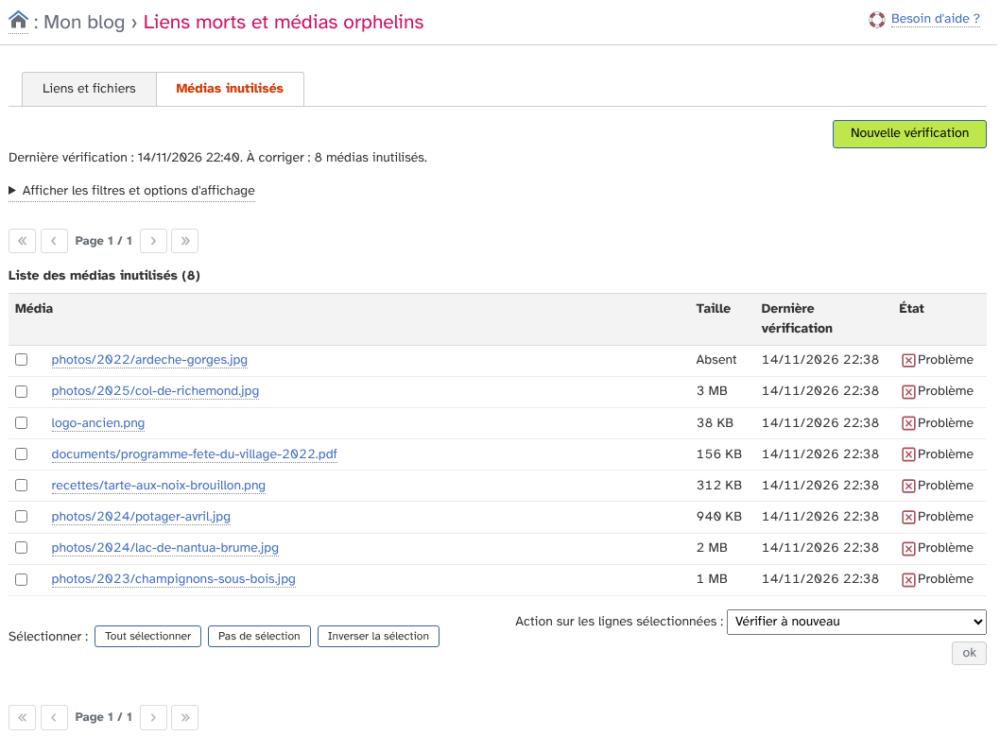

Les colonnes sont **Média** (son chemin dans la médiathèque, avec un lien vers sa page dans la médiathèque),
**Taille**, **Dernière vérification** et **État**. Dans la colonne _Taille_, **Absent** signifie que le média est
listé dans la médiathèque, mais que son fichier n'est plus sur le disque.

Un média est considéré comme utilisé s'il est lié à un billet (annexe, média à la une…), s'il apparaît dans le
contenu d'un billet (lui ou une de ses miniatures), ou si son chemin se retrouve dans les billets des autres
blogs, dans les descriptions des catégories et des blogs ou dans les réglages (thèmes, widgets). En cas de
doute, un média est « utilisé ».

### Précautions avant de supprimer

Un média inutilisé n'est pas forcément inutile.

* Un fichier de thème, ou un autre plugin, peut encore l'utiliser sans que le plugin le sache.
* La liste peut être ancienne : un billet a pu changer depuis la dernière vérification.

Avant de supprimer :

1. cliquez sur le média pour le voir dans la médiathèque,
2. ignorez les médias que vous gardez, pour qu'ils ne reviennent plus dans la liste,
3. ne supprimez que ce dont vous êtes sûr : la suppression est définitive, il n'y a pas de corbeille.

À la suppression, chaque média est recherché une dernière fois dans les billets. S'il est utilisé entre-temps,
il est conservé.

## Filtres et options d'affichage

Le lien **Afficher les filtres et options d'affichage**, au-dessus de chaque liste, déplie le même bloc que les
autres listes de Dotclear.

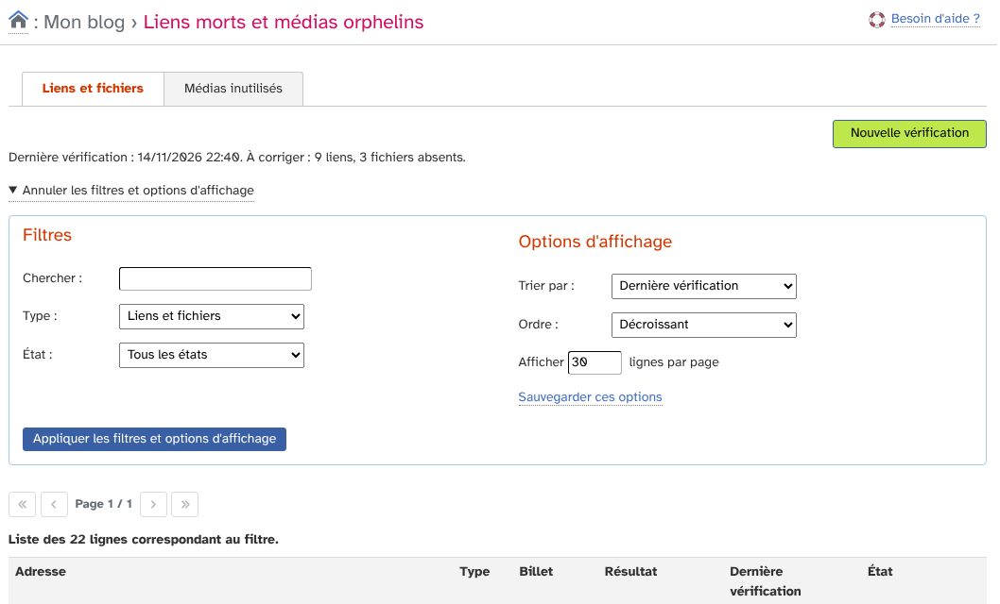

Filtres :

* **Chercher** : un mot ou un bout d'adresse ou de titre de billet, sans tenir compte des majuscules ni des accents.
* **Type** (liste des liens et fichiers seulement) : _Liens et fichiers_, _Liens_ ou _Fichiers_.
* **État** : _À corriger_ (par défaut : les lignes _Problème_ et _À vérifier_), _Problème_, _À vérifier_,
  _Ignoré_, _Sans problème_, _Non vérifié_ ou _Tous les états_.

Pour revoir les lignes ignorées, choisissez l'état **Ignoré**, puis **Appliquer les filtres et options d'affichage**.

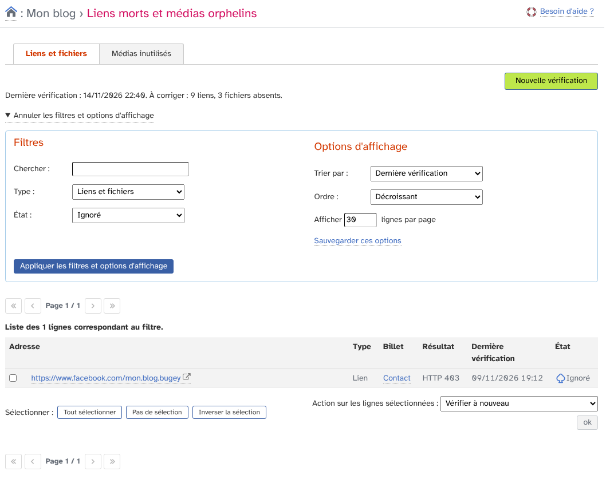

Options d'affichage :

* **Trier par** : _Dernière vérification_ (par défaut), _Adresse_, _Billet_, _Type_ ou _État_ pour les liens et
  fichiers ; _Dernière vérification_, _Média_ ou _État_ pour les médias.
* **Ordre** : croissant ou décroissant (décroissant par défaut).
* **Afficher _n_ lignes par page** (_médias par page_ pour les médias inutilisés) : 30 par défaut.

Le lien **Sauvegarder ces options** garde le tri et le nombre de lignes par page pour vos prochaines visites.
Chaque liste a ses propres options, qui se retrouvent aussi dans vos préférences, onglet _Mes options_.

## Agir sur plusieurs lignes

Cochez des lignes (les boutons _Tout sélectionner_, _Pas de sélection_ et _Inverser la sélection_ aident), puis
choisissez une action en bas de la liste et cliquez sur **ok** :

* **Vérifier à nouveau** : les billets concernés sont relus et les liens redemandés. Un billet que vous avez
  corrigé perd ses problèmes. C'est aussi le moyen de ne plus ignorer une ligne.
* **Ignorer** : la ligne reste dans le rapport, à l'état _Ignoré_. Elle n'est plus comptée dans ce qui est à
  corriger, et les vérifications suivantes la laissent telle quelle.
* **Oublier jusqu'à la prochaine vérification** : la ligne est supprimée du rapport. Si le problème existe
  toujours, la prochaine vérification la retrouve.
* **Supprimer de la médiathèque** (médias inutilisés seulement) : après une confirmation, supprime le média et
  son fichier.

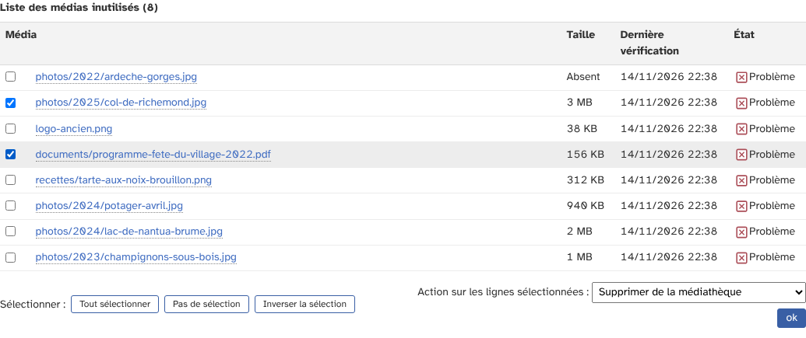

La différence entre _Ignorer_ et _Oublier_ tient à la mémoire :

* un lien que vous **ignorez** est un lien que vous avez examiné et que vous gardez : le plugin s'en souvient et
  ne le signale plus, d'une vérification à l'autre ;
* une ligne que vous **oubliez** est seulement retirée de la vue : elle n'était ni réglée ni acceptée, et revient
  si le problème est toujours là.

Après _Supprimer de la médiathèque_, un message dit combien de médias ont été supprimés, et combien ont été
conservés (utilisés depuis la dernière vérification, ignorés ou non autorisés par vos permissions sur la
médiathèque).

## Le favori du tableau de bord

Le plugin propose un favori, qui donne le nombre de problèmes à corriger. Chaque personne le règle pour
elle-même, dans ses **Préférences**, onglet _Mon tableau de bord_ : dans _Autres favoris disponibles_, cochez
**Liens morts et médias orphelins**, puis cliquez sur _Ajouter à mes favoris_.

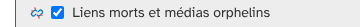

Le favori apparaît dans le menu et sous forme d'icône sur le tableau de bord. Son titre donne le nombre de
problèmes à corriger (lignes _Problème_ et _À vérifier_, liens, fichiers et médias ensemble), par exemple
« 20 problèmes à corriger ». S'il n'y en a aucun, il affiche le nom du plugin.

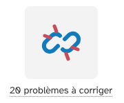

## La tâche du plugin Maintenance

La même vérification est une tâche du plugin _Maintenance_. Elle se trouve dans _Plugins › Entretien_,
onglet _Entretien_, dans le groupe _Autre_ : **Vérifier les liens et les médias des billets**.

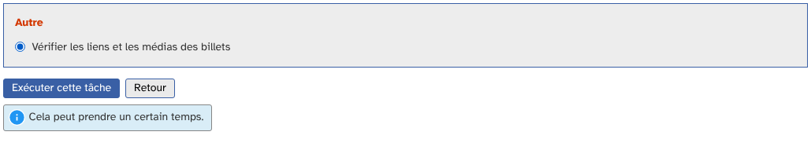

Cochez la tâche et cliquez sur **Exécuter cette tâche** : la vérification se fait par étapes, comme sur la page
du plugin, et la page de la tâche en affiche l'avancement. Une vérification commencée depuis la page du plugin est
continuée par la tâche. La tâche est réservée aux personnes qui ont accès au plugin.

L'intérêt de la tâche est le rappel : dans l'onglet _Réglage des alertes_ du plugin Maintenance, vous pouvez
activer les messages d'alerte et choisir un délai : Dotclear vous prévient alors
qu'il est temps de la refaire. Rien ne se lance tout seul : Dotclear n'a pas de tâches planifiées, et le plugin n'en ajoute pas.

## Avec un assistant IA

Si le plugin [ClaudetteMcp](https://github.com/JcDenis/ClaudetteMcp) est installé sur le blog, un assistant IA
connecté au blog (Claude, par exemple) peut lire le rapport. On peut alors lui demander, en langage naturel :

* « Y a-t-il des liens morts dans mes billets ? »,
* « Quels billets contiennent des images qui ont disparu de la médiathèque ? »,
* « Quels médias ne sont utilisés par aucun billet ? ».

_Orphelins_ ajoute un seul outil au connecteur :

| Outil | Rôle |
|---|---|
| `list_content_problems` | Lire le résultat de la dernière vérification : la date, le nombre de lignes par type et par état, puis les lignes, par type (`link`, `file`, `unused_media`), par état (`to_fix` par défaut, `problem`, `to_verify`, `ignored`, `ok`, `not_checked`, `all`) ou par texte cherché, 50 lignes par page |

Quelques règles :

* L'outil ne fait que lire. L'assistant ne lance pas de vérification, n'ignore rien et ne supprime aucun média.
  Il lit le rapport tel qu'il est : si la dernière vérification est ancienne, lancez-en une nouvelle depuis
  l'administration.
* L'assistant agit avec les droits de l'utilisateur de la clé de connexion, qui doit pouvoir gérer tous les billets du blog.
* Il lui est demandé de ne jamais présenter un média inutilisé comme supprimable sans réserve, pour la raison
  vue plus haut.
* Après l'installation ou la mise à jour d'_Orphelins_, reconnectez le connecteur de l'assistant pour valider le
  nouvel outil.

ClaudetteMcp n'est pas nécessaire au fonctionnement du plugin.

## Limites connues

* **Un média utilisé seulement par un fichier de thème**, ou par les données d'un autre plugin, est vu comme
  inutilisé. D'où les précautions plus haut, l'action _Ignorer_ et l'absence de suppression automatique.
* **Les sites qui refusent les robots** répondent par une erreur ou un refus, et donnent des _À vérifier_.
  Mettez-les dans les domaines à ne pas vérifier.
* **Les adresses locales et privées** (réseau interne, `localhost`…) ne sont jamais demandées : elles restent
  _Non vérifié_. Seul le site du blog lui-même fait exception.
* **Les commentaires ne sont pas vérifiés** : seuls les liens et les médias des billets le sont.
* **Une vérification à la fois par blog.** Deux vérifications lancées en même temps sur le même blog se gênent.
* **Un blog avec beaucoup de médias inutilisés** peut demander une recherche longue dans la dernière étape.
* **Une vérification ne remplace pas un coup d'œil.** Un site peut répondre « 200 » et afficher une page vide,
  ou refuser les robots alors que le lien fonctionne : le résultat dit ce que le serveur du blog a obtenu, à
  l'instant de la vérification.
